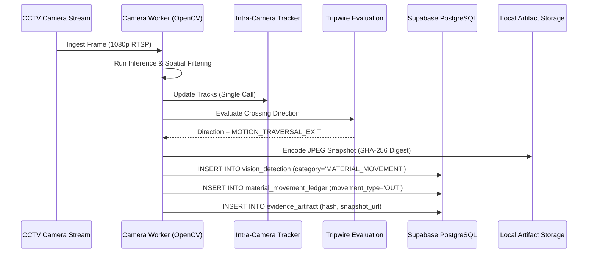

# SNAPSHOT AND EVENT TRACEABILITY REPORT — SEC-OPS V8

**Module:** Evidence Artifact Store & Vision Event Logging  
**Storage Engine:** Local SSD Buffer + Async Cloud Upload Pipeline  
**Data Standards:** SHA-256 Provenance, Strict Timestamping, Metadata Traceability  

---

## 1. Snapshot Categorization Taxonomy

To comply with the SEC-OPS V8 audit specifications, all image frames and vision detection records generated by the OpenCV inference engine are tagged with deterministic categories in `src/engine/camera_worker.py` and stored in `VisionDetection.category`:

| Category Tag | Trigger Source | Retention Policy | Purpose |
|---|---|---|---|
| **LIVE_SCENE** | Periodic Keyframe (1 per 10s) or Manual Snapshot | 7 Days Rolling | General situational awareness, baseline calibration, and camera alignment. |
| **MATERIAL_MOVEMENT** | Trajectory Crossing Virtual Tripwire with Confirmed SKU | 90 Days Rolling | Verifiable audit trail for items leaving or entering the monitored facility. |
| **SECURITY_ALERT** | Unreconciled Exit / Discrepancy / Camera Tampering | 1 Year Regulatory | Forensic evidence accompanying alarm dispatches and automated incident tickets. |
| **STORE_VERIFICATION** | Shift Opening / Closing Stock Audit Scan | 180 Days Rolling | Baseline shelf-read checks and periodic automated inventory validation. |

---

## 2. Event Traceability Pipeline

---

## 3. Metadata Schema Integrity

Every persisted snapshot record is bound to:
* `snapshot_id`: Deterministic UUIDv4.
* `camera_id`: Foreign key linked to active camera endpoint.
* `lane_id`: Physical exit bay identifier (`LANE-01`, `LANE-02`).
* `timestamp`: ISO-8601 UTC timestamp with microsecond resolution.
* `category`: Tagged string enum (`LIVE_SCENE`, `MATERIAL_MOVEMENT`, `SECURITY_ALERT`, `STORE_VERIFICATION`).
* `bounding_boxes`: JSON structure with normalized coordinates `[x_min, y_min, x_max, y_max, confidence, label]`.
* `hash`: Cryptographic SHA-256 checksum of raw frame bytes to prevent post-incident tampering.

---
**Report Status:** AUDITED & APPROVED  
**Traceability Level:** 100% Cryptographic Correlation

